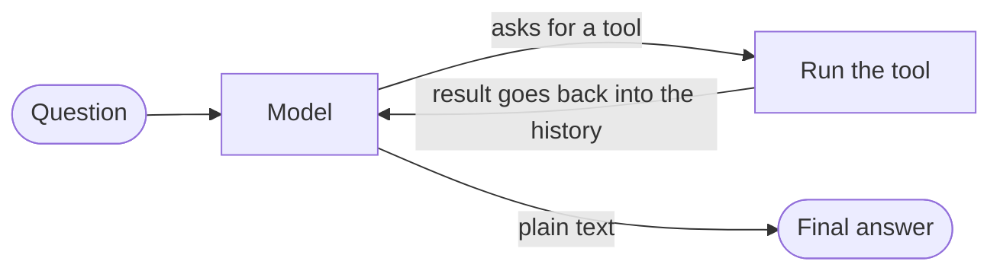

# agentic-loop-explained

A readable tutorial on AI agents: reasoning, context, memory and tools, with a hand-written loop
and a LangGraph version side by side.

The example agent is a data analyst. It answers business questions about a CSV: it profiles the
data, **writes and runs Python**, reads the results, **fixes its own errors**, draws charts and
saves a report. It is built to teach how an agent works:

- what an agent is made of: **reasoning, context, memory and tools**,
- what the **agentic loop** does, step by step,
- how **state, memory and tools** fit in,
- how a framework (**LangGraph**) expresses the loop, side by side with the same loop written by hand.



## Quick start

```bash
pip install -r requirements.txt
cp .env.example .env              # then fill in AZURE_BASE_URL, AZURE_MODEL, AZURE_API_KEY
python generate_data.py           # creates data/sales.csv

python agent.py "Which region underperformed in Q3 compared to Q2, and why?"
python agent.py                   # interactive; follow-up questions keep context
python agent_manual_loop.py "..." # the same agent with a hand-written loop
```

Charts go to `charts/`, reports to `reports/`. Any OpenAI-compatible endpoint works.

## Where to look

| You want to... | Read |
|---|---|
| Understand the vocabulary (agent, tool, state, memory...) | [docs/01-concepts.md](docs/01-concepts.md) |
| See one real run, message by message | [docs/02-agentic-loop.md](docs/02-agentic-loop.md) |
| Compare the LangGraph and hand-written loops | [docs/03-langgraph-vs-manual.md](docs/03-langgraph-vs-manual.md) |
| Learn how tools are defined and called | [docs/04-tools.md](docs/04-tools.md) |
| Try the optional behaviours (approval, plan, review...) | [docs/05-behaviours.md](docs/05-behaviours.md) |
| Know how the project is built and where state lives | [docs/06-architecture.md](docs/06-architecture.md) |
| Present or extend the demo | [docs/07-demo-guide.md](docs/07-demo-guide.md) |

Suggested reading order for the code: `prompts/system.md` → `tools.py` → `agent_manual_loop.py`
→ `agent.py`.

## Files

| File | Role |
|---|---|
| `prompts/system.md` | The agent's instructions: role and method, free of dataset specifics. Edit it freely. |
| `prompts/planner.md`, `prompts/reviewer.md` | Prompts for the optional `--plan` and `--review` steps. |
| `tools.py` | The three tools (`describe_dataset`, `run_python`, `save_report`) and the sandbox. |
| `agent_manual_loop.py` | The loop in ~20 lines of plain Python. |
| `agent.py` | The same agent as a LangGraph graph, plus optional behaviours. |
| `display.py` | Console output only (no agent logic). |
| `config.py` | Environment, model client, prompt loading. |
| `generate_data.py` | Builds the synthetic dataset with a planted story. |

## Optional behaviours (`agent.py` flags, all off by default)

| Flag | What it adds | Concept |
|---|---|---|
| `--approve` | You approve (or reject with feedback) each piece of code before it runs | human-in-the-loop, `interrupt` |
| `--max-steps N` | The model sees its remaining budget; at zero it must answer | loop termination |
| `--plan` | A planning step runs before the first action | plan-then-act |
| `--review` | A reviewer node checks the answer against the evidence | multi-node graphs |
| `--keep-outputs N` | Only the last N tool outputs stay visible to the model | context hygiene |
| `--prompt FILE` | Use a different system prompt | prompts are configuration |

Token usage is always printed. Set `PRICE_INPUT_PER_M` and `PRICE_OUTPUT_PER_M` in `.env` to also
get a cost estimate. Details and real results: [docs/05-behaviours.md](docs/05-behaviours.md).

## Safety note

`run_python` runs model-written code with `exec` inside your own process. That is fine for a local
demo with a dataset you trust, and **not** safe for untrusted input. Use a container or a hosted
sandbox for anything real. Try `--approve` to see every piece of code before it runs.

## License

[MIT](LICENSE) © 2026 István Szatmári

## Models

Tested with Azure OpenAI `gpt-5.4-nano`; `gpt-4o` also works.
Pricing: https://azure.microsoft.com/en-us/pricing/details/azure-openai/
