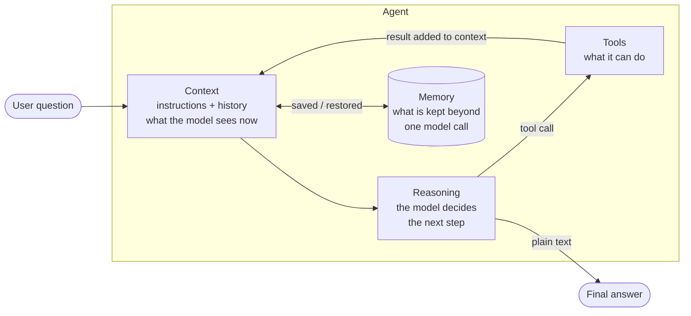
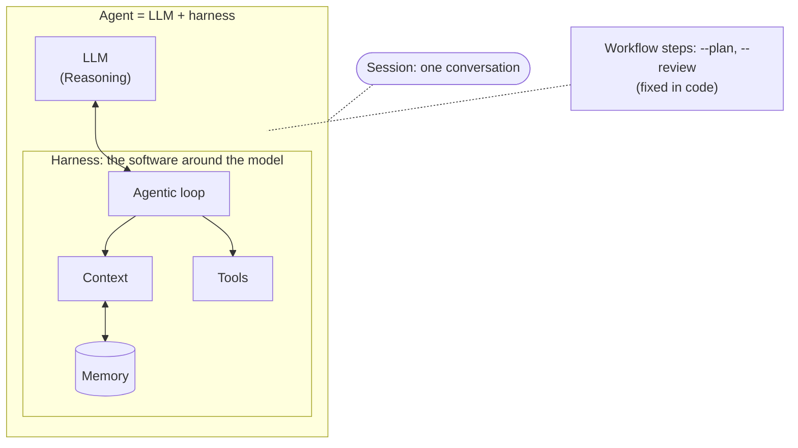

# 1. Concepts

## What is an agent?

A plain LLM call is one question and one answer. An **agent** is an LLM placed in a **loop** with
**tools**, so it can act, look at what happened, and decide what to do next. How this relates to
the words *LLM*, *harness*, *workflow* and *session* is in
[Terminology](#terminology-how-the-words-relate).

## The four building blocks

The commonly used definition of an agent is **Reasoning + Context + Memory + Tools**:

| Block | The question it answers | In this project | Where |
|---|---|---|---|
| **Reasoning** | What should happen next? | The LLM. Optionally a `--plan` step before acting and a `--review` step after. | `make_llm()` in [config.py](../config.py); `agent_node`, `plan_node`, `review_node` in [agent.py](../agent.py) |
| **Context** | What does the model see *right now*? | The system prompt (instructions) + the message history, including every tool result. Limited by the context window; `--keep-outputs` trims it. | [prompts/system.md](../prompts/system.md); `state["messages"]`; `trim_history` |
| **Memory** | What is kept beyond a single model call? | Short-term: the checkpointer (per `thread_id`) and the sandbox variables. Long-term: not implemented. | `MemorySaver` in `build_graph`; `NAMESPACE` in [tools.py](../tools.py) |
| **Tools** | What can it do besides talk? | `describe_dataset`, `run_python`, `save_report`. | [tools.py](../tools.py) |

The **loop** is what connects them: build the context, let the model reason, run the tools it asked
for, put the results back into the context, repeat.

### Context versus memory

These two are easy to mix up:

- **Context** is what is inside the model's window for *this one call*. It is rebuilt and re-sent on
  every step. If it is not in the context, the model does not know it.
- **Memory** is what is **stored** outside the model so it can outlive a call (or a run). Memory
  only helps once something from it is **loaded back into the context**.

The model itself is stateless. The checkpointer stores the message history (memory) and each turn
loads it into the context. `--keep-outputs` shapes the context without deleting anything from
memory: the full history stays stored, only the copy sent to the model is trimmed.

### Instructions are part of the context

The system prompt is the instruction part of the context: the one piece you write as plain text.
It is a file (`prompts/system.md`) so you can change the agent's behaviour without touching code,
and it is kept free of dataset-specific facts: what the data contains comes from the tools
(`describe_dataset`), not from the prompt.

## Terminology: how the words relate

These words are used loosely in the field. Below is how this tutorial uses them, with the four
building blocks above as the definition of an agent, and how Anthropic uses the same words. In
short: the **LLM** reasons; the **harness** gives it context, memory and tools and runs the loop;
together they are the **agent**.

| Term | In this tutorial | Anthropic's usage |
|---|---|---|
| **LLM** | The model alone. It is the **Reasoning** block: it decides the next step and can request a tool, but it runs nothing and remembers nothing between calls. | A component inside the harness. In Claude Code, Claude is the model inside the harness ([glossary](https://code.claude.com/docs/en/glossary)). |
| **Agent** | The four building blocks working together in a loop: Reasoning, Context, Memory, Tools. In code, the model plus the harness. | The LLM directs its own steps and tool use ([Building effective agents](https://www.anthropic.com/engineering/building-effective-agents)). A short form from a later post: an LLM using tools in a loop ([context engineering](https://www.anthropic.com/engineering/effective-context-engineering-for-ai-agents)). |
| **Agentic loop** | The model decides, a tool runs, the result goes back into the context, and this repeats until the model answers in plain text. `--max-steps` is the safety stop. | Gather context, act, verify, repeat ([glossary](https://code.claude.com/docs/en/glossary), [Agent SDK post](https://claude.com/blog/building-agents-with-the-claude-agent-sdk)). Feedback from the environment at each step, stopping conditions and human checkpoints are covered in [Building effective agents](https://www.anthropic.com/engineering/building-effective-agents). |
| **Workflow** | LLM calls on a path fixed in code. The default loop is not one, because the model chooses its own tool calls. `--plan` and `--review` add fixed steps, so with them on this tutorial is a hybrid. | LLMs and tools orchestrated through predefined code paths. Workflows and agents together are called agentic systems ([Building effective agents](https://www.anthropic.com/engineering/building-effective-agents)). |
| **Harness** | Everything around the model: `agent.py` or `agent_manual_loop.py`, plus `tools.py`, the prompts and the display. It provides the tools, manages context and memory, runs the loop and executes the tools. | The layer around the model that supplies tools, manages context and runs the loop. In Claude Code, Claude Code is the harness ([glossary](https://code.claude.com/docs/en/glossary), [how it works](https://code.claude.com/docs/en/how-claude-code-works), [evals post](https://www.anthropic.com/engineering/demystifying-evals-for-ai-agents)). |
| **Session** | One conversation, identified by a `thread_id`. Interactive mode is one session; a new command starts a new one. Its history is the short-term **Memory** block, kept in RAM. | Used in two ways. In Claude Code, a conversation with its own context window ([glossary](https://code.claude.com/docs/en/glossary)). In Managed Agents, a durable log that lives outside the context window ([Managed Agents](https://www.anthropic.com/engineering/managed-agents)). |

### Where the usage differs

- **"Agent" is used at two levels.** Behaviourally: the model directs its own steps, as opposed to a
  workflow. Structurally: model plus harness (the evals post), or session plus harness plus sandbox
  (the Managed Agents post).
- **LLM and model are not defined separately.** The sources use them interchangeably.
- **The four building blocks are a teaching framing, not Anthropic's wording.** They are common in
  the field and fit Anthropic's view of an LLM augmented with retrieval, tools and memory, and its
  writing on context. The two views are compatible, not identical.
- **"Building effective agents" dates from December 2024.** It notes that parts of it are dated, so
  the loop and harness definitions above lean on the later pages.

### Sources

- [Building effective agents](https://www.anthropic.com/engineering/building-effective-agents) (Dec 2024)
- [Effective context engineering for AI agents](https://www.anthropic.com/engineering/effective-context-engineering-for-ai-agents) (Sep 2025)
- [Building agents with the Claude Agent SDK](https://claude.com/blog/building-agents-with-the-claude-agent-sdk) (Sep 2025)
- [Demystifying evals for AI agents](https://www.anthropic.com/engineering/demystifying-evals-for-ai-agents) (Jan 2026)
- [Scaling Managed Agents](https://www.anthropic.com/engineering/managed-agents) (Apr 2026)
- [Claude Code glossary](https://code.claude.com/docs/en/glossary) and [How Claude Code works](https://code.claude.com/docs/en/how-claude-code-works)

## Vocabulary

| Term | Meaning here |
|---|---|
| **Message** | One entry in the conversation. Four kinds: `SystemMessage` (instructions), `HumanMessage` (the user), `AIMessage` (the model), `ToolMessage` (a tool result). |
| **Tool call** | An `AIMessage` that contains a request like "call `run_python` with `code=...`" instead of (or next to) text. It has an `id`. |
| **Tool result** | A `ToolMessage` carrying the function's return value, matched to the call by `tool_call_id`. |
| **State** | The data the loop carries from step to step. Here: the list of messages (plus a few counters). |
| **Termination** | The agentic loop ends when the model replies without tool calls. A step limit protects against loops that never end. |
| **Context** | Everything the model is given for one call: instructions, history, tool results. |
| **Context window** | The maximum text the model can read in one call. The whole history must fit. |
| **Thread** | One conversation, identified by a `thread_id`. This project's implementation of a *session* (see [Terminology](#terminology-how-the-words-relate)). |
| **Checkpointer** | Saves the state after each step, keyed by thread, so a later question continues the conversation. |
| **Sandbox** | The place where model-written code runs. |

## Memory: what is handled and what is not

"Memory" means several different things. This project handles some and deliberately leaves
the rest as documented limits.

| Kind of memory | Handled? | How |
|---|---|---|
| **Within one question** (the steps so far) | Yes | The message list in the state. `--keep-outputs` keeps it small. |
| **Across questions in one session** | Yes | `MemorySaver` checkpointer, keyed by `thread_id`. |
| **Variables in the sandbox** (`df`, `clean`...) | Yes, in process | The `NAMESPACE` dict in `tools.py`. It is separate from the checkpoint. |
| **Across restarts** | No | `MemorySaver` lives in RAM. A persistent checkpointer would restore messages, but the sandbox variables would still be gone. See [06-architecture.md](06-architecture.md#state-lives-in-two-places). |
| **Long-term facts across sessions** | No | Would need a store or a notes file the agent reads and writes. A good exercise. |
| **Very long sessions** | Partly | `--keep-outputs` trims old tool outputs; user and model messages still grow. Eventually you need summarization. |

A key point: **the model has no memory of its own.** If it is not in the messages sent this turn,
the model does not know it.

## Why a loop, not one big prompt?

The agent cannot know the answer in advance. It must look at the data, form a hypothesis, test it,
and see the result before deciding the next move. Each tool result changes what the right next
step is. That is why the output of one step must flow back into the next call.

Next: [02-agentic-loop.md](02-agentic-loop.md) shows this on a real run.
