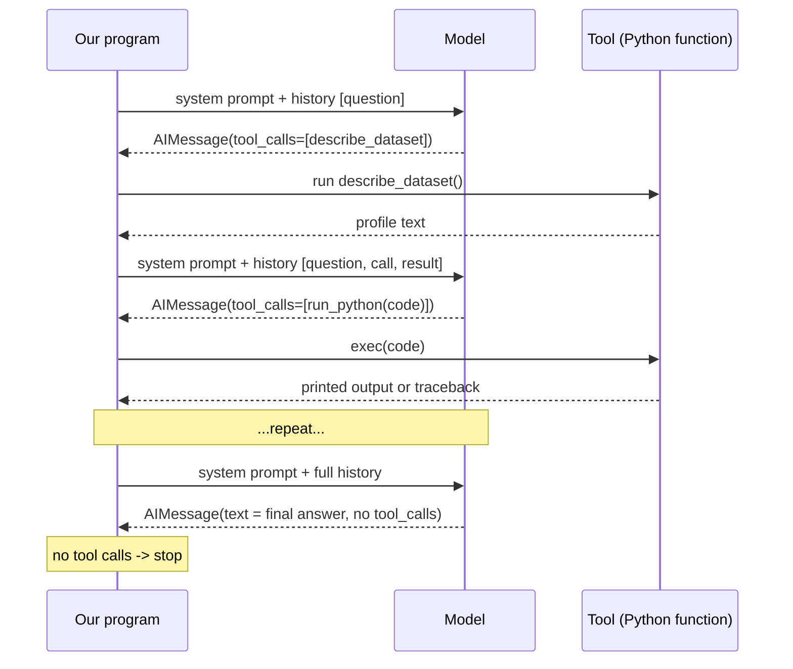

# 2. The agentic loop, step by step

This page follows one real run: *"Which region underperformed in Q3 compared to Q2, and why?"*
on `gpt-5.4-nano` with no optional behaviours. The full console output is in
[transcripts/plain-loop.txt](transcripts/plain-loop.txt). Your run will differ in details: models are
not deterministic.

## The loop in one picture



Every arrow from the program to the model carries the **entire history**, not just the latest
message. That is the whole trick, and also the main cost driver.

## What the model saw and did

### Turn 1: explore

History sent: `[system prompt, "Which region underperformed...?"]` (829 input tokens).

The model replied with **no text, only a tool call**:

```text
AIMessage(content="", tool_calls=[{"name": "describe_dataset", "args": {}, "id": "call_..."}])
```

Our program ran `describe_dataset()` and appended the result as a `ToolMessage`. The profile showed
15,357 rows, 40 duplicates, `channel` nulls and a stray `'east '` region label, exactly the mess the
system prompt tells the agent to look for.

### Turn 2: clean

The model now sees the question, its own tool call, and the profile. It wrote code that normalizes
the region labels, drops duplicates and adds a `quarter` column, and ran it with `run_python`. The
printed shape and quarter counts came back as the next tool result.

### Turn 3 and 4: a mistake and the self-correction

On turn 3 the model ended its code with a bare expression:

```python
comp.sort_values('revenue_pct_change').round(4).head(10)
```

`run_python` returned `(code ran successfully, nothing was printed)`. The tool description says
*"bare expressions are NOT echoed"*, but the model skipped it. It read the empty result, understood
the problem, and on turn 4 wrote `print(comp_sorted[...])`. Nobody told it to; the tool result was
enough. **Errors and surprises are returned as ordinary text, so the loop corrects itself.**

The same mechanism handles real exceptions: the traceback is returned and the model fixes the code
([transcripts/manual-loop.txt](transcripts/manual-loop.txt) has several `KeyError`s and
`AttributeError`s that the agent fixes on its own).

### Turn 5: a second fix

The first cleaning step only stripped whitespace, so `'east '` became `'east'`, still different from
`'East'`. On turn 5 the model noticed a stray region in its own output and added an explicit
`.replace({'east': 'East'})`. It then confirmed East as the underperformer (-31%).

### Turns 6 and 7: drill down

It segmented East by product, channel, discount, units per order and status until it found the
driver: the **Pro** line.

### Turns 8 to 10: charts

Three `run_python` calls, each ending with `plt.savefig(...)`. The tool reported the new file paths
back (`[charts saved: ...]`).

### Turn 11: save the report

The model called `save_report` with a Markdown write-up, and the tool returned the file path. (In
this recording the agent saved a report on its own, because the prompt of that time told it to
always do so. Today the prompt says to save one only when the user asks for a report.)

### Turn 12: final answer

The model replied with **text only**. No tool calls means the loop stops:

```text
**Answer:** East underperformed in Q3 vs Q2, with revenue down $140.6k (-30.7%). The driver was a
collapse in Pro performance in East...
```

## How the history grows

Every turn adds the model's message and the tool result, and everything is re-sent. Input tokens per
model call in this run:

| Call | 1 | 2 | 3 | 4 | 5 | 6 | 7 | 8 | 9 | 10 | 11 | 12 |
|---|---|---|---|---|---|---|---|---|---|---|---|---|
| Input tokens | 829 | 1,409 | 1,673 | 1,880 | 2,095 | 2,518 | 3,080 | 3,490 | 3,858 | 4,290 | 4,585 | 5,093 |

The total was **34,800 input tokens for 3,088 output tokens**. The agent only *wrote* 3k tokens but
*re-read* 35k. Longer analyses grow roughly quadratically. This is why `--keep-outputs` exists (see
[05-behaviours.md](05-behaviours.md#--keep-outputs-n-context-hygiene)).

## The loop can be wrong

In this run the model reported that revenue "is fulfilled in both quarters (backordered is $0), so
the drop is not fulfillment related". That is a faulty inference: backordered orders have zero
revenue by construction, so they would never show up as revenue. The planted root cause *is* a
stockout. A reviewer step (`--review`) exists to catch this kind of unsupported reasoning; see the
behaviours page. An agent loop makes mistakes recoverable, not impossible.

## Takeaways

1. The model only ever **requests**; our code **acts**.
2. Tool results are fed back as messages, so the next decision sees them.
3. Errors are data. Returning them (instead of crashing) is what gives self-correction.
4. The loop stops when the model produces text instead of a tool call.
5. Cost grows with the history, because the history is re-sent every time.

Next: [03-langgraph-vs-manual.md](03-langgraph-vs-manual.md) shows the same loop in code.
