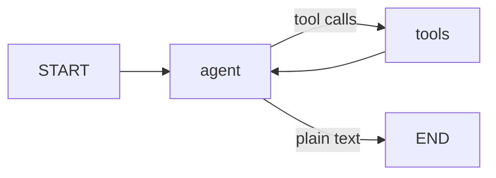

# 3. LangGraph vs. the hand-written loop

The repository contains the same agent twice, with the same tools, prompt and model:

| | [agent_manual_loop.py](../agent_manual_loop.py) | [agent.py](../agent.py) |
|---|---|---|
| The loop | A `for` loop you can read in 20 lines | A graph: nodes and edges |
| Memory across questions | A Python list you keep passing in | A checkpointer keyed by `thread_id` |
| Extras (approval, plan, review, budget) | None, on purpose | Flags |

Read the manual version first: it *is* the idea. Then read the graph version to see how a framework
expresses it and what it adds.

## The loop as pseudocode

```text
history = []
on each user question:
    history.append(question)
    repeat up to MAX_STEPS:
        reply = model(system_prompt + history)        # THINK
        history.append(reply)
        if reply has no tool calls:                   # DECIDE
            return reply.text                         # the final answer
        for each call in reply.tool_calls:            # ACT
            result = run(call.name, call.args)
            history.append(result tagged with call.id)
```

## Side by side

**Hand-written** (`agent_manual_loop.py`):

```python
def run_agent(llm, system_prompt, history, question):
    history.append(HumanMessage(question))
    for step in range(1, MAX_STEPS + 1):
        reply = llm.invoke([SystemMessage(system_prompt), *history])      # THINK
        history.append(reply)
        if not reply.tool_calls:                                          # DECIDE
            return
        for call in reply.tool_calls:                                     # ACT
            result = TOOLS_BY_NAME[call["name"]].invoke(call["args"])
            history.append(ToolMessage(content=result, tool_call_id=call["id"], name=call["name"]))
```

**LangGraph** (`agent.py`, with all flags off):

```python
graph = StateGraph(AgentState)
graph.add_node("agent", agent_node)            # THINK: calls the model
graph.add_node("tools", ToolNode(TOOLS))       # ACT: runs the requested tools
graph.add_edge(START, "agent")
graph.add_conditional_edges("agent", route_after_agent)   # DECIDE: "tools" or END
graph.add_edge("tools", "agent")               # results always go back to the model
app = graph.compile(checkpointer=MemorySaver())
```



## Concept mapping

| Hand-written | LangGraph | Notes |
|---|---|---|
| `history` (a list) | `state["messages"]` | `MessagesState` *appends* node outputs instead of overwriting |
| `llm.invoke([...])` | `agent_node` | A node is a function: state in, partial state update out |
| `if not reply.tool_calls: return` | `route_after_agent` → `END` | A *conditional edge* chooses the next node by inspecting state |
| the `for call in ...` block | `ToolNode(TOOLS)` | Prebuilt: runs each call, appends the `ToolMessage` |
| the `for step in range(MAX_STEPS)` bound | `recursion_limit` in the run config | Hard safety net on the number of graph steps |
| passing `history` between questions | `MemorySaver` + `thread_id` | State is saved after every node |
| `print` inside the loop | `app.stream(..., stream_mode="updates")` | Yields `{node: output}` after each node |

## What the framework gives you

The two versions behave the same at the default settings. LangGraph pays off when you add things
around the loop. In `agent.py` each of these is a few lines of graph wiring:

| Capability | Used for | Why it is awkward by hand |
|---|---|---|
| **Checkpointing** | Conversation memory; pausing and resuming | You must serialize and restore state yourself |
| **`interrupt()`** | `--approve`: pause mid-run for a human, then resume | You must restructure the loop into a resumable form |
| **Streaming updates** | Showing each step as it happens | You add your own callbacks |
| **Extra nodes and routing** | `--plan`, `--review` | The `while` loop grows branches and flags |
| **Visualisation** | `app.get_graph().draw_mermaid()` | Not available |

Without these needs, the manual loop is simpler and has fewer moving parts. Many production agents
are exactly this loop plus error handling.

## Anatomy of the graph version

```text
AgentState        the data flowing through: messages + steps + reviews + review_ok
agent_node        reads state, calls the model, returns {"messages": [reply], "steps": ...}
ToolNode          reads the last AIMessage's tool_calls, returns ToolMessages
route_after_agent looks at the last message and returns the name of the next node
build_graph()     registers nodes and edges, then compile() makes it runnable
ask()             streams the run; handles pauses from interrupt()
```

A node returns only the keys it changes. For `messages`, the returned list is *added* to the
existing one, which is why `agent_node` can return `{"messages": [reply]}` and not the whole history.

Next: [04-tools.md](04-tools.md).
