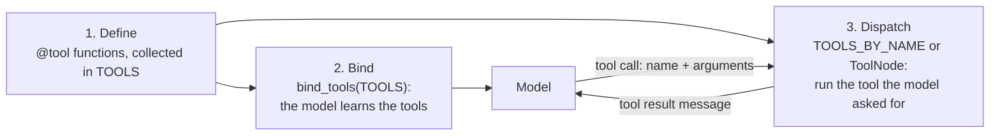
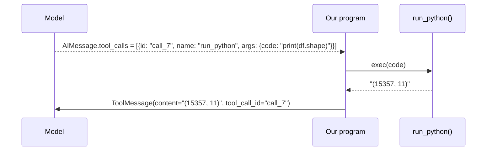

# 4. Tools: define, bind, dispatch

A **tool** is a normal Python function that the model may ask us to call. All three tools live in
[tools.py](../tools.py).

A tool goes through three separate stages. Keeping them apart is the key to understanding how an
agent uses tools:

| Stage | What happens | Where in the code |
|---|---|---|
| **1. Define** | You write a function and `@tool` wraps it in a tool object. The tool objects are collected in the list `TOOLS`. | [tools.py](../tools.py) |
| **2. Bind** | The model is told the tools exist: their names, descriptions and argument schemas are sent with every request. | `bind_tools(TOOLS)`: in `main()` of [agent_manual_loop.py](../agent_manual_loop.py), in `build_graph()` of [agent.py](../agent.py) |
| **3. Dispatch** | When the model asks for a tool, our code finds it by name, runs it, and sends the result back. | manual: `TOOLS_BY_NAME` and a `for` loop in `run_agent()`. LangGraph: `ToolNode(TOOLS)` |



**Binding tells the model what exists. Dispatch actually runs it.** The model never runs anything
itself. Both stages read the same `TOOLS` list, which is what keeps them in step.

---

## 1. Define

### What `@tool` does

`@tool` is a decorator from `langchain_core`. It takes your plain function and **replaces it with a
tool object** (a `StructuredTool`) that carries the function plus everything the model needs to know
about it. It reads three things from your code:

| It reads... | And stores it as... |
|---|---|
| the function **name** | `tool.name` |
| the **docstring** | `tool.description` |
| the **parameters and type hints** | `tool.args_schema`, a schema object built from the signature (`tool.args` shows it) |

The original function is kept inside as `tool.func`. This is what the object looks like when you
poke at `run_python`:

```python
type(run_python).__name__   # 'StructuredTool'
run_python.name             # 'run_python'
run_python.args             # {'code': {'title': 'Code', 'type': 'string'}}
run_python.func("print(2+3)")            # 5   <- the original function, called directly
run_python.invoke({"code": "print(2+3)"})  # 5   <- the standard way: a dict of arguments
run_python("print(2+3)")                 # TypeError: the tool object is not a plain function
```

Two consequences follow:

- After decoration, `run_python` is **no longer a normal function**. You run a tool with
  `.invoke({...})`, passing a dict of named arguments. That is exactly what the model produces
  (`args: {"code": "..."}`), so `ToolNode` and the manual loop both just call
  `tool.invoke(call["args"])`.
- The decorator **does not run anything** and does not talk to the model. It only packages the
  function. Nothing about the model happens until stage 2, `bind_tools`.

### The collection: `TOOLS`

```python
TOOLS = [describe_dataset, run_python, save_report]
```

This one list is imported by both agents. Stage 2 gives it to the model and stage 3 gives it to the
code that runs the tools.

### Writing a good definition

The definition is the only thing the model knows about a tool, so it is worth writing carefully:

- **Name:** a short phrase that says what the tool does (`run_python`, `describe_dataset`).
- **Docstring:** written for the model, not for a developer. Say *when* to use the tool, *what* it
  returns, what is already set up (`df` is preloaded) and what goes wrong (bare expressions are
  not echoed).
- **Type hints on every parameter.** They become the argument schema. A parameter with no default
  is required.
- **Return text.** Whatever you return is converted to a string for the model.
- **Make errors helpful.** Return a message that says what would work, not only what failed.
- **Few tools, clearly different.** Overlapping tools make the model's choice harder.

**The docstring is a prompt.** Notice that the `run_python` docstring states what is preloaded, how
to see output, how to save charts, and what happens on errors. A vague docstring produces a model
that misuses the tool. For more on this, see Anthropic's post
[Writing effective tools for AI agents](https://www.anthropic.com/engineering/writing-tools-for-agents).

---

## 2. Bind

Binding is how the model learns that the tools exist.

```python
agent_llm = base_llm.bind_tools(TOOLS)      # done once, when the agent is built
reply = agent_llm.invoke(messages)          # every model call now carries the tools
```

`bind_tools` converts each tool object into a JSON schema and stores the list on the model object.
From then on, every `invoke` sends that list in the `tools` field of the request, next to the
messages:

```text
@tool-decorated function --bind_tools--> [one JSON schema per tool] --invoke--> request:
                                                                     { "messages": [...],
                                                                       "tools":    [...] }
```

You never write the JSON or call a conversion yourself. `bind_tools` generates it automatically,
using `convert_to_openai_tool` from `langchain_core.utils.function_calling`, which you can call
yourself to print it.

### What the model receives

Here is the `run_python` tool as written in `tools.py` (function body omitted):

```python
@tool
def run_python(code: str) -> str:
    """Execute Python code in a persistent session and return its printed output.

    - A pandas DataFrame `df` is preloaded with the raw dataset.
    - pd, np and plt are already imported. Variables persist between calls.
    - Use print() to see results; bare expressions are NOT echoed.
    - Save charts with plt.savefig(f"{CHART_DIR}/<descriptive_name>.png", dpi=150,
      bbox_inches="tight") and then plt.close(). Always use CHART_DIR: saving anywhere
      else fails with an error. Saved charts are listed as "[charts saved: charts/<name>.png]".
    - If the code raises, the full traceback is returned so you can fix it.
    """
```

| Part of the function | In `run_python` | Becomes (in the JSON below) | The model uses it to... |
|---|---|---|---|
| Name | `run_python` | `name` | refer to the tool in a call |
| Docstring | the text above | `description` | decide **when** to use it and **how** |
| Parameters and type hints | `code: str` | `parameters` (a JSON schema) | produce valid arguments |

And this is the JSON the model receives for that same function. Compare it line by line with the
code above:

```json
{
  "type": "function",
  "function": {
    "name": "run_python",
    "description": "Execute Python code in a persistent session and return its printed output.\n\n- A pandas DataFrame `df` is preloaded with the raw dataset.\n- pd, np and plt are already imported. Variables persist between calls.\n- Use print() to see results; bare expressions are NOT echoed.\n- Save charts with plt.savefig(f\"{CHART_DIR}/<descriptive_name>.png\", dpi=150,\n  bbox_inches=\"tight\") and then plt.close(). Always use CHART_DIR: saving anywhere\n  else fails with an error. Saved charts are listed as \"[charts saved: charts/<name>.png]\".\n- If the code raises, the full traceback is returned so you can fix it.",
    "parameters": {
      "type": "object",
      "properties": { "code": { "type": "string" } },
      "required": ["code"]
    }
  }
}
```

`code: str` became `"code": {"type": "string"}`, and it is `required` because it has no default
value. A tool with no parameters, such as `describe_dataset()`, simply gets an empty `properties`
object, so the model calls it with `{}`. The JSON above is what `bind_tools` produces; the provider
library may add options (such as a `strict` flag) to the actual request.

That is all "giving the model tools" means: a list of names, descriptions and argument schemas sent
with each request.

### Binding in the two agents

| | Manual loop | LangGraph |
|---|---|---|
| Code | `llm = make_llm().bind_tools(TOOLS)` in `main()` | `agent_llm = base_llm.bind_tools(TOOLS)` in `build_graph()` |
| Model objects | one model object, with tools | two: `agent_llm` (with tools) for the agent node, and `base_llm` (no tools) for the planner, the reviewer and the forced final answer, which must not call tools |

Binding runs nothing and changes nothing outside the model object. A tool that is bound but not
dispatched is just a promise nobody keeps (see the end of stage 3).

---

## 3. Dispatch and usage

Dispatch is what happens when the model replies with a tool call instead of text.



The program has to do four things: **look up** the tool by `call["name"]`, **run** it with
`call["args"]`, **wrap** the result in a `ToolMessage` carrying the call's `id`, and **append** it to
the history so the next model call sees it.

Rules worth knowing:

- A reply can contain **several** tool calls. Each needs its own result message.
- The result is matched to the call by **`tool_call_id`**. A call without a result is an API error;
  that is why the `--approve` rejection path still returns a `ToolMessage` for every call.
- The result is always **text**. If you return a number or a table, it is converted to a string.

### Dispatch in the two agents

**Manual loop** (`run_agent()` in `agent_manual_loop.py`): you write the four steps yourself.

```python
TOOLS_BY_NAME = {t.name: t for t in TOOLS}          # the lookup table

for call in reply.tool_calls:
    result = TOOLS_BY_NAME[call["name"]].invoke(call["args"])                      # look up + run
    tool_message = ToolMessage(content=result, tool_call_id=call["id"], name=call["name"])   # wrap
    history.append(tool_message)                                                   # append
```

**LangGraph** (`build_graph()` in `agent.py`): the prebuilt `ToolNode` does all four steps.

```python
tools_node = ToolNode(TOOLS)                # builds the same lookup from the same list
graph.add_node("tools", tools_node)         # runs every tool call in the last AI message
graph.add_edge("tools", "agent")            # results always go back to the model
```

The graph also decides *whether* to dispatch: after each agent turn, a conditional edge routes to
`tools` if the reply contains tool calls, and ends the run if it does not. With `--approve`, the
`approval` node sits in front of `tools` and can send control back to the agent instead.

| | Manual loop | LangGraph |
|---|---|---|
| Lookup | `TOOLS_BY_NAME`, built by you | built inside `ToolNode` from the list you give it |
| Running | `.invoke(call["args"])` in your `for` loop | the `tools` node |
| Result message | you build the `ToolMessage` | `ToolNode` builds and appends it |
| Deciding whether to dispatch | `if not reply.tool_calls: return` | the conditional edge after the agent node |
| Model asks for an unknown tool | `KeyError`: the program stops | an error message is returned to the model: "…is not a valid tool, try one of [describe_dataset, run_python, save_report]" |
| A tool raises an exception | the program stops, unless the tool catches it (`run_python` does) | the run stops with the exception too: `ToolNode` turns only an unknown tool name into a message, not an exception raised inside a tool |

The manual loop is deliberately minimal and has no error handling. A production loop would add
what `ToolNode` gives you for unknown names, and would also catch exceptions raised inside tools,
which neither version does for you. That is why `run_python` catches its own errors and returns
them as text.

### Bind and dispatch must agree

The two stages are independent: nothing checks that they use the same tools. Giving both the same
`TOOLS` list avoids the two ways they can disagree:

| Disagreement | What happens |
|---|---|
| **Bound but not dispatched** | The model asks for a tool nobody can run. Manual: a `KeyError`. LangGraph: an error message goes back to the model. |
| **Dispatched but not bound** | The model never learns the tool exists, so it never asks for it. The tool is dead code. |

### How the model chooses a tool

The model chooses among the bound tools by reading their descriptions, and the system prompt can
add strategy ("Explore first: call `describe_dataset`"). So the choice is a language problem, not
code. If the model picks the wrong tool, improve the docstring first.

---

## The three tools

| Tool | Arguments | Character | Why it is here |
|---|---|---|---|
| `run_python` | `code` | General, powerful, open-ended | One tool that can do any analysis. Returns output and tracebacks. |
| `describe_dataset` | none | Narrow, safe, deterministic | A cheap, reliable first step. Shows that a specific tool beats general code for a known job. It also reports the time range of any date-like column. |
| `save_report` | `title`, `markdown` | Has a side effect (writes a file) | Shows a tool that *does* something, not only reads. Called **only when the user asks** for a report; a natural place for approval in a real system. |

## Design choices in `run_python`

| Choice | Reason |
|---|---|
| **Persistent namespace** (`NAMESPACE`) | Variables survive between calls, like a notebook. The model builds up `clean`, `q2`, `q3` step by step instead of re-running everything. |
| **Errors returned, not raised** | The traceback becomes the tool result; the model reads it and fixes its code. Self-correction comes from this. |
| **`print()` capture** | Only what is printed is returned, so the model controls how much it reads. |
| **Output truncated at 6,000 chars** | A huge print would be re-sent on every later turn. |
| **New charts reported** | The tool appends `[charts saved: charts/<name>.png]` so the model can cite exact paths. |
| **Charts may only go to `CHART_DIR`** | A guard around matplotlib's `savefig` raises an error for any other path, and the error tells the model the correct call. This was added after a real bug: the model saved charts to `../charts/` and they landed outside the project. A prompt rule alone was not enough, so the tool now checks, and the error is fed back like any other traceback. |
| **`exec` in-process** | Simple, but **not a sandbox**. See the safety note below. |

## Design choices in `save_report`

| Choice | Reason |
|---|---|
| **Called only on request** | The tool description and `prompts/system.md` say to save a report only if the user asks for one ("...and save a report"). A tool with a side effect should not fire unasked. The model follows this most of the time, but it is an instruction, not a guarantee. |
| **The question is added by code** | The model only supplies `title` and `markdown`. The tool prepends a header with the exact question, the data file and the date, taken from `RUN_CONTEXT` in `tools.py`, which the agent loop fills in for every question. Facts that must be right are better written by code than left to the model. |
| **One path form for charts** | The model always writes charts as `charts/<name>.png`, the same form `run_python` prints. `save_report` adds the `../` needed inside a file in `reports/`. Giving the model two forms (one for saving, one for linking) is what caused the bug above: it copied the link form, `../charts/`, as a save path. |
| **Path returned relative to the project** | Short for the model to quote, and it does not depend on where you launched the command. |

## Adding your own tool

Walk through the three stages:

1. **Define.** Write the function with type hints and a docstring written for the model, and
   decorate it with `@tool`.
2. **Add it to `TOOLS`** at the bottom of `tools.py`. This one step covers stages 2 and 3: both
   agents bind and dispatch whatever is in the list, so there is no other wiring.
3. **Optional:** only if the model needs strategy beyond the docstring, add a line about *when* to
   use it in `prompts/system.md` (the "Using the tools" section). The docstring already tells it
   *what* the tool does, so the prompt does not repeat that.

Example: a tool that lists the distinct values of one column.

```python
@tool
def column_values(column: str) -> str:
    """Return the distinct values of one column of the raw dataset, with counts.
    Use it to check category labels. Fails with a message if the column does not exist."""
    if column not in _raw_df.columns:
        return f"ERROR: unknown column {column!r}. Columns: {list(_raw_df.columns)}"
    return _raw_df[column].value_counts(dropna=False).to_string()

TOOLS = [describe_dataset, run_python, save_report, column_values]
```

Note the error handling: an unknown column returns a helpful message, so the model can retry
correctly. Prefer messages that tell the model what *would* work.

## Safety

`run_python` executes model-written code in your process, with your permissions. For anything beyond
a demo, run it in a container or a hosted sandbox with no network and limited files. A smaller
step: run `agent.py --approve`, which asks you before each `run_python` call.

Next: [05-behaviours.md](05-behaviours.md).
