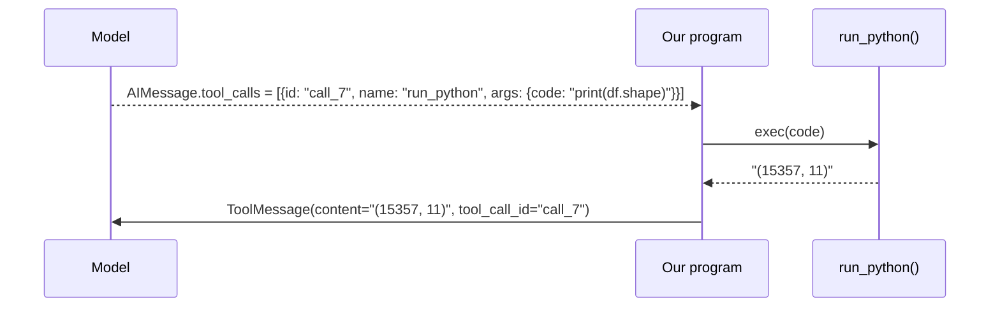

# 4. Tools: definition and usage

A **tool** is a normal Python function that the model may ask us to call. All three tools live in
[tools.py](../tools.py).

## From function to contract

### What `@tool` does

`@tool` is a decorator from `langchain_core`. It takes your plain function and **replaces it with a
tool object** (a `StructuredTool`) that carries the function plus everything the model needs to know
about it. It reads three things from your code:

| It reads... | And stores it as... |
|---|---|
| the function **name** | `tool.name` |
| the **docstring** | `tool.description` |
| the **parameters and type hints** | `tool.args_schema`, a schema object built from the signature (`tool.args` shows it) |

The original function is kept inside as `tool.func`. This is what the object looks like when you
poke at `run_python`:

```python
type(run_python).__name__   # 'StructuredTool'
run_python.name             # 'run_python'
run_python.args             # {'code': {'title': 'Code', 'type': 'string'}}
run_python.func("print(2+3)")            # 5   <- the original function, called directly
run_python.invoke({"code": "print(2+3)"})  # 5   <- the standard way: a dict of arguments
run_python("print(2+3)")                 # TypeError: the tool object is not a plain function
```

Two consequences follow:

- After decoration, `run_python` is **no longer a normal function**. You run a tool with
  `.invoke({...})`, passing a dict of named arguments. That is exactly what the model produces
  (`args: {"code": "..."}`), so `ToolNode` and the manual loop both just call
  `tool.invoke(call["args"])`.
- The decorator **does not run anything** and does not talk to the model. It only packages the
  function. Nothing about the model happens until `bind_tools` (below).

### What the model receives

Here is the `run_python` tool as written in `tools.py` (function body omitted):

```python
@tool
def run_python(code: str) -> str:
    """Execute Python code in a persistent session and return its printed output.

    - A pandas DataFrame `df` is preloaded with the raw dataset.
    - pd, np and plt are already imported. Variables persist between calls.
    - Use print() to see results; bare expressions are NOT echoed.
    - Save charts with plt.savefig(f"{CHART_DIR}/<descriptive_name>.png", dpi=150,
      bbox_inches="tight") and then plt.close().
    - If the code raises, the full traceback is returned so you can fix it.
    """
```

| Part of the function | In `run_python` | Becomes (in the JSON below) | The model uses it to... |
|---|---|---|---|
| Name | `run_python` | `name` | refer to the tool in a call |
| Docstring | the text above | `description` | decide **when** to use it and **how** |
| Parameters and type hints | `code: str` | `parameters` (a JSON schema) | produce valid arguments |

And this is the JSON the model receives for that same function. You never write it or call a
conversion yourself: `bind_tools` (next section) generates it from the tool object
automatically. To print it, call `convert_to_openai_tool(run_python)` (from
`langchain_core.utils.function_calling`), which is what `bind_tools` runs internally. Compare it
line by line with the code above:

```json
{
  "type": "function",
  "function": {
    "name": "run_python",
    "description": "Execute Python code in a persistent session and return its printed output.\n\n- A pandas DataFrame `df` is preloaded with the raw dataset.\n- pd, np and plt are already imported. Variables persist between calls.\n- Use print() to see results; bare expressions are NOT echoed.\n- Save charts with plt.savefig(f\"{CHART_DIR}/<descriptive_name>.png\", dpi=150,\n  bbox_inches=\"tight\") and then plt.close().\n- If the code raises, the full traceback is returned so you can fix it.",
    "parameters": {
      "type": "object",
      "properties": { "code": { "type": "string" } },
      "required": ["code"]
    }
  }
}
```

`code: str` became `"code": {"type": "string"}`, and it is `required` because it has no default
value. A tool with no parameters, such as `describe_dataset()`, simply gets an empty `properties`
object, so the model calls it with `{}`.

**The docstring is a prompt.** It is read by the model, not by a developer. Notice that the
`run_python` docstring states what is preloaded, how to see output, how to save charts, and what
happens on errors. A vague docstring produces a model that misuses the tool.

### How the schemas reach the model: `bind_tools`

```python
agent_llm = base_llm.bind_tools(TOOLS)      # agent.py: done once, when the graph is built
reply = agent_llm.invoke(messages)          # every model call now carries the tools
```

`bind_tools` converts each tool object to the JSON above and stores the list on the model object.
From then on, every `invoke` sends that list in the `tools` field of the request, next to the
messages:

```text
@tool-decorated function --bind_tools--> [one JSON schema per tool] --invoke--> request:
                                                                     { "messages": [...],
                                                                       "tools":    [...] }
```

That is all "giving the model tools" means: a list of names, descriptions and argument schemas
sent with each request. The model replies with a tool call in the same format, and our program
runs the function (see the call cycle below). The JSON shown above is what `bind_tools` produces;
the provider library may add options (such as a `strict` flag) to the actual request.

## The call cycle



Rules worth knowing:

- A reply can contain **several** tool calls. Each needs its own result message.
- The result is matched to the call by **`tool_call_id`**. A call without a result is an API error;
  that is why the `--approve` rejection path still returns a `ToolMessage` for every call.
- The result is always **text**. If you return a number or a table, it is converted to a string.

## The three tools

| Tool | Arguments | Character | Why it is here |
|---|---|---|---|
| `run_python` | `code` | General, powerful, open-ended | One tool that can do any analysis. Returns output and tracebacks. |
| `describe_dataset` | none | Narrow, safe, deterministic | A cheap, reliable first step. Shows that a specific tool beats general code for a known job. It also reports the time range of any date-like column. |
| `save_report` | `title`, `markdown` | Has a side effect (writes a file) | Shows a tool that *does* something, not only reads. Called **only when the user asks** for a report; a natural place for approval in a real system. |

The prompt tells the model which to use when ("Explore first: call `describe_dataset`"). The model
chooses among tools by reading their descriptions, so the choice is a language problem, not code.

## Design choices in `run_python`

| Choice | Reason |
|---|---|
| **Persistent namespace** (`NAMESPACE`) | Variables survive between calls, like a notebook. The model builds up `clean`, `q2`, `q3` step by step instead of re-running everything. |
| **Errors returned, not raised** | The traceback becomes the tool result; the model reads it and fixes its code. Self-correction comes from this. |
| **`print()` capture** | Only what is printed is returned, so the model controls how much it reads. |
| **Output truncated at 6,000 chars** | A huge print would be re-sent on every later turn. |
| **New charts reported** | The tool appends `[charts saved: charts/<name>.png]` so the model can cite exact paths. |
| **Charts may only go to `CHART_DIR`** | A guard around matplotlib's `savefig` raises an error for any other path, and the error tells the model the correct call. This was added after a real bug: the model saved charts to `../charts/` and they landed outside the project. A prompt rule alone was not enough, so the tool now checks, and the error is fed back like any other traceback. |
| **`exec` in-process** | Simple, but **not a sandbox**. See the safety note below. |

## Design choices in `save_report`

| Choice | Reason |
|---|---|
| **Called only on request** | The tool description and `prompts/system.md` say to save a report only if the user asks for one ("...and save a report"). A tool with a side effect should not fire unasked. The model follows this most of the time, but it is an instruction, not a guarantee. |
| **The question is added by code** | The model only supplies `title` and `markdown`. The tool prepends a header with the exact question, the data file and the date, taken from `RUN_CONTEXT` in `tools.py`, which the agent loop fills in for every question. Facts that must be right are better written by code than left to the model. |
| **One path form for charts** | The model always writes charts as `charts/<name>.png`, the same form `run_python` prints. `save_report` adds the `../` needed inside a file in `reports/`. Giving the model two forms (one for saving, one for linking) is what caused the bug above: it copied the link form, `../charts/`, as a save path. |
| **Path returned relative to the project** | Short for the model to quote, and it does not depend on where you launched the command. |

## Adding your own tool

1. Write the function with type hints and a docstring written for the model.
2. Decorate with `@tool`.
3. Add it to `TOOLS` at the bottom of `tools.py`.
4. Only if the model needs strategy beyond the docstring, add a line about *when* to use it in
   `prompts/system.md` (the "Using the tools" section). The docstring already tells it *what* the
   tool does, so the prompt does not repeat that.

Both `agent.py` and `agent_manual_loop.py` pick it up, because they build everything from `TOOLS`.

Example: a tool that lists the distinct values of one column.

```python
@tool
def column_values(column: str) -> str:
    """Return the distinct values of one column of the raw dataset, with counts.
    Use it to check category labels. Fails with a message if the column does not exist."""
    if column not in _raw_df.columns:
        return f"ERROR: unknown column {column!r}. Columns: {list(_raw_df.columns)}"
    return _raw_df[column].value_counts(dropna=False).to_string()

TOOLS = [describe_dataset, run_python, save_report, column_values]
```

Note the error handling: an unknown column returns a helpful message, so the model can retry
correctly. Prefer messages that tell the model what *would* work.

## Safety

`run_python` executes model-written code in your process, with your permissions. For anything beyond
a demo, run it in a container or a hosted sandbox with no network and limited files. A smaller
step: run `agent.py --approve`, which asks you before each `run_python` call.

Next: [05-behaviours.md](05-behaviours.md).
