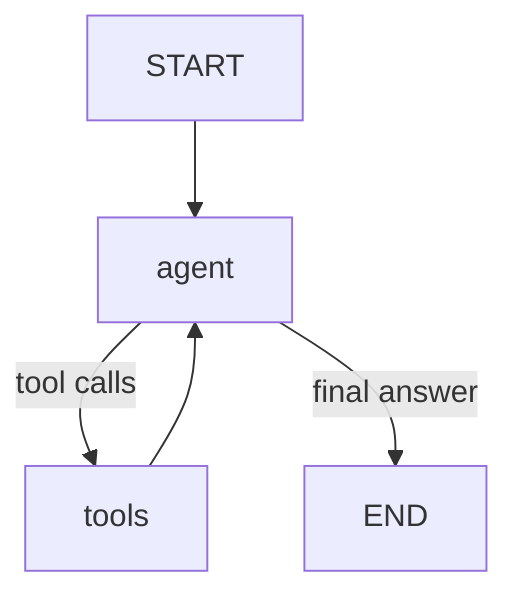
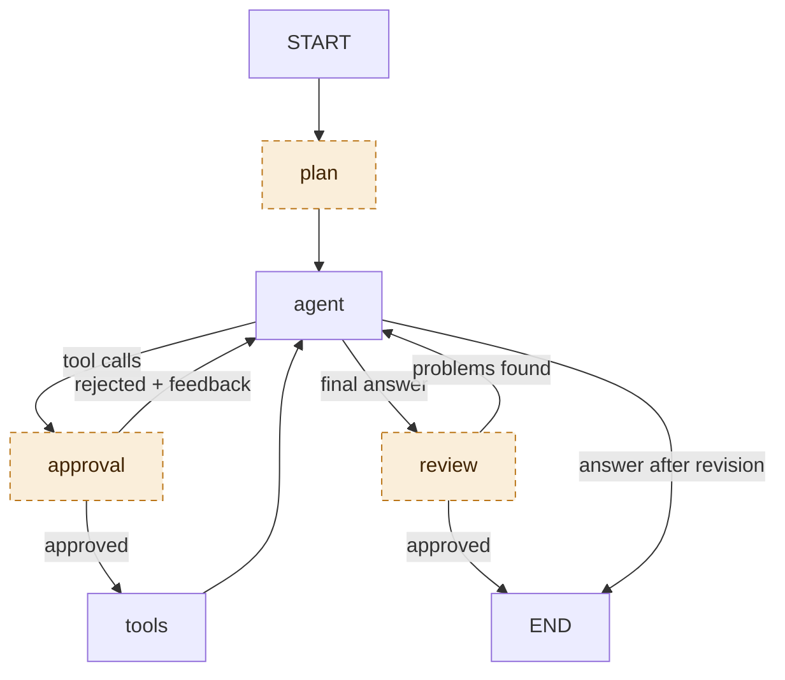
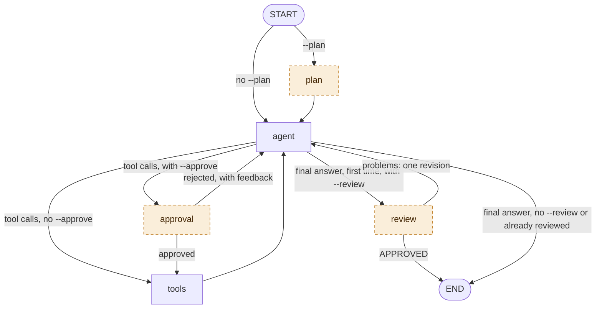

# 5. Optional behaviours

`agent.py` can add behaviours around the basic loop. Each one is **off by default** and lives
behind a flag, so the default run is the plain loop from [02-agentic-loop.md](02-agentic-loop.md).
Each teaches one idea.

| Flag | Idea | Changes the graph? | Prompt it uses | Extra model calls per question |
|---|---|---|---|---|
| `--approve` | Human in the loop | adds an `approval` node | none (it is not a model call) | 0 (you are asked once per `run_python` call) |
| `--max-steps N` | Bounded loops | no | none of its own; adds a one-line system note to the agent's calls | 0 |
| `--plan` | Plan, then act | adds a `plan` node | `prompts/planner.md` | exactly 1 |
| `--review` | A second pair of eyes | adds a `review` node and a loop-back | `prompts/reviewer.md` | 1, plus the revision turns if it objects |
| `--keep-outputs N` | Context hygiene | no | none | 0 |
| `--prompt FILE` | Prompts are configuration | no | replaces `prompts/system.md` for the agent | 0 |
| *(always on)* | Token tracking | no | none | 0 |

## Which prompt does each model call use?

A run makes up to three kinds of model call. Each has its **own system message**; they never share
one.

| Model call | System message | Other input | Tools bound | How often, per question |
|---|---|---|---|---|
| **Agent turn** | `prompts/system.md`, or the file given with `--prompt`. With `--max-steps`, one short budget note is added after the history. | the conversation so far (with `--keep-outputs`, old tool outputs are stubs) | yes | once for every tool-calling turn, plus once for the final answer |
| **Planner** (`--plan`) | `prompts/planner.md` only | the conversation so far, flattened to plain text | no | exactly once, before the agent's first turn |
| **Reviewer** (`--review`) | `prompts/reviewer.md` only | the same, with each tool output cut to 1,500 characters | no | at most once, when the agent first gives a final answer |

Things to know:

- **`--approve` makes no model call and uses no prompt.** It pauses the graph and asks you.
- **`--prompt` changes only the agent's system prompt.** `planner.md` and `reviewer.md` have fixed
  names and no flag: to change them, edit the files.
- **The agent never sees `planner.md` or `reviewer.md`.** It sees only their output, as messages in
  its history: the plan text, or the reviewer's feedback.
- **"Per question" means each question you type.** In interactive mode every follow-up starts the
  counters again: a new plan, a new review, a new step budget.
- **When the files are read.** The agent's system prompt is read once, at startup. `planner.md` and
  `reviewer.md` are read each time their node runs, so an edit applies from the next question
  without a restart. (The run header's prompt hashes are computed at startup.)

## Default graph vs. all flags

Three of the flags add nodes to the graph. Here are both versions, drawn the same way so you can
compare them. **Default, no flags:** the plain loop.



**All flags on:** the same `agent` and `tools` loop, plus three optional nodes drawn with a dashed
border.



Dashed nodes exist only when their flag is set:

| Dashed node | Flag | What it adds to the graph |
|---|---|---|
| `plan` | `--plan` | runs once per question, before the agent's first turn |
| `approval` | `--approve` | sits between `agent` and `tools`; can send control back to `agent` |
| `review` | `--review` | runs when `agent` first gives a final answer, at most once per question; can send it back for one revision |

`--max-steps`, `--keep-outputs`, `--prompt` and token tracking do not change the graph. They change
what the model is told or sees.

Try them together:

```bash
python agent.py data/sales.csv --approve --plan --review --max-steps 10 --keep-outputs 2 "Which region underperformed in Q3, and why?"
```

The same graph as a single diagram. The flag that enables each path is written on the edge, and
the three optional nodes are dashed:



---

## `--approve`: human in the loop

**What it does.** Before every `run_python` call the graph stops and shows you the code. Answer
`y` (or Enter) to run it, or type feedback to reject it. The rejection and your text go back to the
model as the tool result, and it adjusts.

**Prompt and how often.** None: this is not a model call, so there is no system prompt. You are
asked **once for each `run_python` call** the agent makes. If one agent turn contains several
calls, you are asked in order, and the first rejection rejects all of them. `describe_dataset` and
`save_report` are never asked. A rejection costs one more agent turn, because the model must read
your feedback and try again.

**How it works.** The `approval_node` calls `interrupt({...})`. LangGraph saves the state with the
checkpointer and returns control to `ask()`, which prompts you and resumes with
`Command(resume=answer)`. This is why a checkpointer is required: the graph is paused, not running.

**Seen in a real run** ([transcript](transcripts/approve-and-budget.txt)): the second piece of code
was rejected with `n`, and the third with *"use groupby instead"*. Both rejections reached the model
as tool results. Combined with `--max-steps 4`, the budget then ran out and the model gave its final
answer instead of retrying.

**Teaches.** Safety for tools with side effects, and that an agent run can be paused and resumed.

## `--max-steps N`: bounded loops

**What it does.** Counts tool-calling turns for the current question. The model is told
`[Budget: K tool-calling step(s) left]` before each turn. At zero, the tools are **removed** for
the next call and the model is told to answer with what it has and say what it could not verify.

**Prompt and how often.** No prompt file of its own and no extra model calls. The agent keeps its
normal system prompt (`system.md`); before each agent call, one extra system message is appended
after the history: the budget note, or the "budget exhausted" note when the budget is zero (that
call is made without tools). The budget counts per question.

**Why not just `recursion_limit`?** That is a hard stop: the run raises an error and the user gets
nothing. A visible budget lets the model plan ("I have 3 steps, skip the third chart") and a forced
final answer degrades gracefully instead of crashing.

**Seen in a real run:** with `--max-steps 4` the agent used its steps, then produced a final answer
instead of continuing.

**Teaches.** Loop termination. Every agent needs an exit that is not "the model felt done".

## `--plan`: plan, then act

**What it does.** A `plan` node runs once per question, before the agent's first turn. It makes one
model call without tools that writes a short numbered plan (hypotheses to test, what to clean, which
charts). The plan is added to the history, so the agent sees it on every turn.

**Prompt and how often.** The call uses [prompts/planner.md](../prompts/planner.md) as its only
system message; the agent's `system.md` is not part of it. The input is the conversation so far,
flattened to plain text, and no tools are bound. It is called **exactly once per question** and
never again within that question: not after a rejected code step, and not after a reviewer's
revision. In interactive mode every follow-up question gets its own plan, and the earlier plans stay
in the history. The agent never sees `planner.md`, only the resulting `PLAN: ...` message, and
nothing forces it to follow the plan.

**Trade-off.** One extra model call and more tokens, in return for a more directed run. The plan is
written before any data was seen (see the real one in
[transcripts/plan-review-trim-budget.txt](transcripts/plan-review-trim-budget.txt): it talks about
"available fields" generically). Compare with the default, where the model plans implicitly while
acting. Plans help most for long, multi-part questions.

**Teaches.** Plan-then-execute versus pure step-by-step reasoning, and how a new node slots into the
graph.

## `--review`: a second pair of eyes

**What it does.** When the agent produces a final answer, a `review` node checks it against the
evidence: are all numbers supported by tool outputs, does the "why" follow from them, were data
quality problems mentioned? It replies `APPROVED` or a list of problems. On problems, the list is
added as a user message and control goes back to the agent for one revision.

**Prompt and how often.** The call uses [prompts/reviewer.md](../prompts/reviewer.md) as its only
system message. The input is the conversation so far as plain text (each tool output cut to 1,500
characters), and no tools are bound. It runs **at most once per question** (`MAX_REVIEWS = 1` in
`agent.py`), the first time the agent answers without a tool call:

- If it replies `APPROVED`, the run ends. The review cost one extra model call.
- If it lists problems, they are added to the history as a user message, and the agent revises:
  one or more agent turns, possibly with tool calls. **The revised answer is not reviewed
  again.**

The agent never sees `reviewer.md`, only the feedback message.

**Seen in a real run:** the reviewer found the answer did not mention the 40 duplicate rows that the
analyst had removed. The agent went back, re-ran its checks, and answered again (from "Step 5" in
the [transcript](transcripts/plan-review-trim-budget.txt)).

**Limits.** The reviewer is the same model reading a text transcript, so it shares blind spots, and
it only sees the first 1,500 characters of each tool output. It is a cheap sanity check, not proof.
There is at most one review per question (`MAX_REVIEWS` in `agent.py`), so the loop cannot ping-pong forever.

**Teaches.** Graphs with several nodes and a conditional loop-back, and the *generator / critic*
pattern.

## `--keep-outputs N`: context hygiene

**The problem.** The whole history is re-sent at every step ([02-agentic-loop.md](02-agentic-loop.md#how-the-history-grows)).
A large output printed early is paid for again at every later step, and a very long run can
overflow the context window or bury what matters.

**What it does.** Before each model call, all tool outputs except the last `N` are replaced by a
one-line stub: `[output omitted to save context: 4,812 chars. Re-run the code if you need it.]`
(only outputs longer than 300 characters are replaced).

**This is truncation, not summarization.**

| | Stubbing (what this does) | Summarizing (an exercise) |
|---|---|---|
| Extra model call | No | Yes |
| Deterministic | Yes | No |
| Keeps meaning of old outputs | No | Mostly |
| Risk | Model forgets a number it only saw there | Summary can distort or drop facts |

Three details keep it safe:

1. Only the **copy sent to the model** is trimmed. The stored state, the checkpoint and the console
   output keep everything.
2. The model's **own text and code are never trimmed**. The system prompt asks it to restate key
   numbers in its own words as it goes, which works like a self-written summary.
3. It is a function (`trim_history` in `agent.py`), easy to replace with a summarizer.

**Measured effect** on the same question, same model, one run each:

| | Model calls | Input tokens | Output tokens |
|---|---|---|---|
| Default | 12 | 34,800 | 3,088 |
| `--keep-outputs 1` | 11 | 28,124 | 3,450 |

About 19% fewer input tokens on a short run. The saving grows with run length because the plain
curve is quadratic. Treat the numbers as indicative: runs vary, and the two did not take the same
number of steps.

**Teaches.** The context window is a budget, and what the model sees can differ from what is stored.

## Token tracking (always on)

Every model call goes through `call_model()` in `agent.py`, which adds the usage to a counter. Each
AI message prints `tokens: in=... out=...`, and the run ends with a total. Watch the per-step `in`
number grow. Set `PRICE_INPUT_PER_M` and `PRICE_OUTPUT_PER_M` in `.env` (price per million tokens)
to also print an estimated cost. Calls made by the planner and reviewer are included.

## `--prompt FILE`: prompts are configuration

`prompts/system.md` is read at startup. Copy it, change it, and run
`python agent.py data/sales.csv --prompt prompts/my_variant.md "..."` to compare behaviour without touching code.
The run header shows the prompt file and a short hash of its text, so you can tell which wording a
saved run used.
Good experiments: remove the chart rules, force a different output format, or tell the agent to
always call `save_report`, instead of only when asked.

---

## Exercises

1. **Summarizing trimmer.** Replace the stub in `trim_history` with a one-sentence model-written
   summary of each old output. Compare tokens and answer quality with the stubs.
2. **Approve only the report.** Make `approval_node` ask for `save_report` instead of `run_python`.
3. **Long-term memory.** Give the agent a `remember(fact)` tool that appends to a notes file, and
   include the file in the system prompt on the next run.
4. **Smarter reviewer.** Let the reviewer call `run_python` to verify a number itself.
5. **Persistent conversations.** Swap `MemorySaver` for a database-backed checkpointer, then notice
   what else must be restored (see [06-architecture.md](06-architecture.md#state-lives-in-two-places)).
