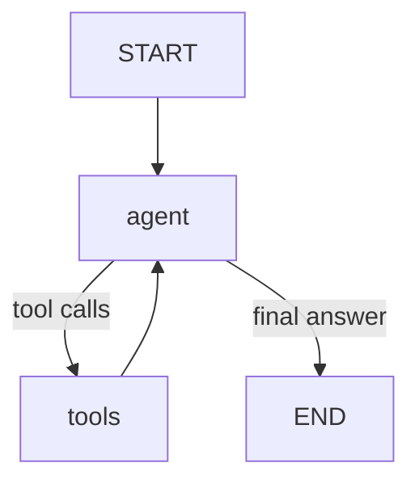
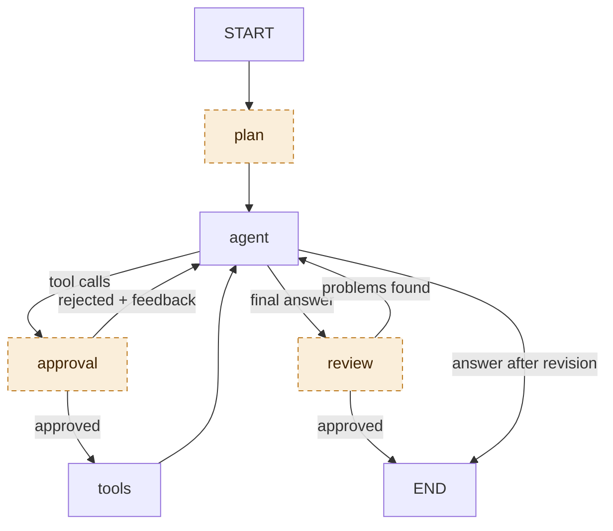

# 5. Optional behaviours

`agent.py` can add behaviours around the basic loop. Each one is **off by default** and lives
behind a flag, so the default run is the plain loop from [02-agentic-loop.md](02-agentic-loop.md).
Each teaches one idea.

| Flag | Idea | Changes the graph? |
|---|---|---|
| `--approve` | Human in the loop | adds an `approval` node |
| `--max-steps N` | Bounded loops | no (changes what the model is told) |
| `--plan` | Plan, then act | adds a `plan` node |
| `--review` | A second pair of eyes | adds a `review` node and a loop-back |
| `--keep-outputs N` | Context hygiene | no (changes what the model sees) |
| `--prompt FILE` | Prompts are configuration | no |
| *(always on)* | Token tracking | no |

## Default graph vs. all flags

Three of the flags add nodes to the graph. Here are both versions, drawn the same way so you can
compare them. **Default, no flags:** the plain loop.



**All flags on:** the same `agent` and `tools` loop, plus three optional nodes drawn with a dashed
border.



Dashed nodes exist only when their flag is set:

| Dashed node | Flag | What it adds to the graph |
|---|---|---|
| `plan` | `--plan` | runs once before `agent` |
| `approval` | `--approve` | sits between `agent` and `tools`; can send control back to `agent` |
| `review` | `--review` | runs when `agent` gives a final answer; can send it back for one revision |

`--max-steps`, `--keep-outputs`, `--prompt` and token tracking do not change the graph. They change
what the model is told or sees.

Try them together:

```bash
python agent.py data/sales.csv --approve --plan --review --max-steps 10 --keep-outputs 2 "Which region underperformed in Q3, and why?"
```

---

## `--approve`: human in the loop

**What it does.** Before every `run_python` call the graph stops and shows you the code. Answer
`y` (or Enter) to run it, or type feedback to reject it. The rejection and your text go back to the
model as the tool result, and it adjusts.

**How it works.** The `approval_node` calls `interrupt({...})`. LangGraph saves the state with the
checkpointer and returns control to `ask()`, which prompts you and resumes with
`Command(resume=answer)`. This is why a checkpointer is required: the graph is paused, not running.

**Seen in a real run** ([transcript](transcripts/approve-and-budget.txt)): the second piece of code
was rejected with `n`, and the third with *"use groupby instead"*. Both rejections reached the model
as tool results. Combined with `--max-steps 4`, the budget then ran out and the model gave its final
answer instead of retrying.

**Teaches.** Safety for tools with side effects, and that an agent run can be paused and resumed.

## `--max-steps N`: bounded loops

**What it does.** Counts tool-calling turns for the current question. The model is told
`[Budget: K tool-calling step(s) left]` before each turn. At zero, the tools are **removed** for
the next call and the model is told to answer with what it has and say what it could not verify.

**Why not just `recursion_limit`?** That is a hard stop: the run raises an error and the user gets
nothing. A visible budget lets the model plan ("I have 3 steps, skip the third chart") and a forced
final answer degrades gracefully instead of crashing.

**Seen in a real run:** with `--max-steps 4` the agent used its steps, then produced a final answer
instead of continuing.

**Teaches.** Loop termination. Every agent needs an exit that is not "the model felt done".

## `--plan`: plan, then act

**What it does.** A `plan` node runs once before the agent. It makes one model call without tools
that writes a short numbered plan (hypotheses to test, what to clean, which charts). The plan is
added to the history, so the agent sees it on every turn. The planner's prompt is
[prompts/planner.md](../prompts/planner.md).

**Trade-off.** One extra model call and more tokens, in return for a more directed run. The plan is
written before any data was seen (see the real one in
[transcripts/plan-review-trim-budget.txt](transcripts/plan-review-trim-budget.txt): it talks about
"available fields" generically). Compare with the default, where the model plans implicitly while
acting. Plans help most for long, multi-part questions.

**Teaches.** Plan-then-execute versus pure step-by-step reasoning, and how a new node slots into the
graph.

## `--review`: a second pair of eyes

**What it does.** When the agent produces a final answer, a `review` node checks it against the
evidence: are all numbers supported by tool outputs, does the "why" follow from them, were data
quality problems mentioned? It replies `APPROVED` or a list of problems. On problems, the list is
added as a user message and control goes back to the agent for one revision. The reviewer's
instructions are in [prompts/reviewer.md](../prompts/reviewer.md).

**Seen in a real run:** the reviewer found the answer did not mention the 40 duplicate rows that the
analyst had removed. The agent went back, re-ran its checks, and answered again (from "Step 5" in
the [transcript](transcripts/plan-review-trim-budget.txt)).

**Limits.** The reviewer is the same model reading a text transcript, so it shares blind spots, and
it only sees the first 1,500 characters of each tool output. It is a cheap sanity check, not proof.
There is at most one revision (`MAX_REVISIONS` in `agent.py`) so the loop cannot ping-pong forever.

**Teaches.** Graphs with several nodes and a conditional loop-back, and the *generator / critic*
pattern.

## `--keep-outputs N`: context hygiene

**The problem.** The whole history is re-sent at every step ([02-agentic-loop.md](02-agentic-loop.md#how-the-history-grows)).
A large output printed early is paid for again at every later step, and a very long run can
overflow the context window or bury what matters.

**What it does.** Before each model call, all tool outputs except the last `N` are replaced by a
one-line stub: `[output omitted to save context: 4,812 chars. Re-run the code if you need it.]`
(only outputs longer than 300 characters are replaced).

**This is truncation, not summarization.**

| | Stubbing (what this does) | Summarizing (an exercise) |
|---|---|---|
| Extra model call | No | Yes |
| Deterministic | Yes | No |
| Keeps meaning of old outputs | No | Mostly |
| Risk | Model forgets a number it only saw there | Summary can distort or drop facts |

Three details keep it safe:

1. Only the **copy sent to the model** is trimmed. The stored state, the checkpoint and the console
   output keep everything.
2. The model's **own text and code are never trimmed**. The system prompt asks it to restate key
   numbers in its own words as it goes, which works like a self-written summary.
3. It is a function (`trim_history` in `agent.py`), easy to replace with a summarizer.

**Measured effect** on the same question, same model, one run each:

| | Model calls | Input tokens | Output tokens |
|---|---|---|---|
| Default | 12 | 34,800 | 3,088 |
| `--keep-outputs 1` | 11 | 28,124 | 3,450 |

About 19% fewer input tokens on a short run. The saving grows with run length because the plain
curve is quadratic. Treat the numbers as indicative: runs vary, and the two did not take the same
number of steps.

**Teaches.** The context window is a budget, and what the model sees can differ from what is stored.

## Token tracking (always on)

Every model call goes through `call_model()` in `agent.py`, which adds the usage to a counter. Each
AI message prints `tokens: in=... out=...`, and the run ends with a total. Watch the per-step `in`
number grow. Set `PRICE_INPUT_PER_M` and `PRICE_OUTPUT_PER_M` in `.env` (price per million tokens)
to also print an estimated cost. Calls made by the planner and reviewer are included.

## `--prompt FILE`: prompts are configuration

`prompts/system.md` is read at startup. Copy it, change it, and run
`python agent.py data/sales.csv --prompt prompts/my_variant.md "..."` to compare behaviour without touching code.
The run header shows the prompt file and a short hash of its text, so you can tell which wording a
saved run used.
Good experiments: remove the chart rules, force a different output format, or tell the agent to
always call `save_report`, instead of only when asked.

---

## Exercises

1. **Summarizing trimmer.** Replace the stub in `trim_history` with a one-sentence model-written
   summary of each old output. Compare tokens and answer quality with the stubs.
2. **Approve only the report.** Make `approval_node` ask for `save_report` instead of `run_python`.
3. **Long-term memory.** Give the agent a `remember(fact)` tool that appends to a notes file, and
   include the file in the system prompt on the next run.
4. **Smarter reviewer.** Let the reviewer call `run_python` to verify a number itself.
5. **Persistent conversations.** Swap `MemorySaver` for a database-backed checkpointer, then notice
   what else must be restored (see [06-architecture.md](06-architecture.md#state-lives-in-two-places)).
