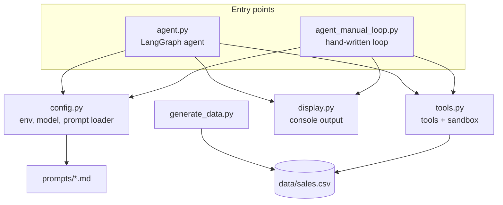
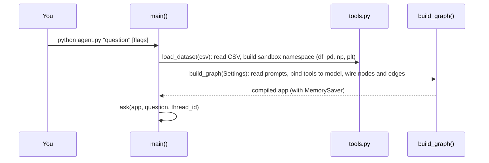

# 6. Architecture and process

## Files and dependencies

The two entry points share everything except the loop. That is deliberate: when you compare them,
the only difference you see is the framework.

## What happens at startup

## What happens during one question

1. `ask()` builds the initial state: the question as a `HumanMessage`, counters set to zero.
2. `app.stream()` runs the graph. After every node it yields `{node: output}`.
3. `display.show_update()` prints each update (thought, code, output, final answer).
4. If a node called `interrupt()`, the stream ends with an `__interrupt__` entry. `ask()` collects
   your answer and resumes with `Command(resume=...)`.
5. When the graph reaches `END`, `ask()` prints the token totals.

## State lives in two places

This is the subtlest part of the design.

| State | Lives in | Saved by the checkpointer? |
|---|---|---|
| Conversation (messages, counters) | The graph state | **Yes** |
| Variables (`df`, `clean`, `q2`...) and files | The `NAMESPACE` dict in `tools.py` and the disk | **No** |

Within one process they stay in step: the model wrote `clean = ...` in an earlier turn, and the
`clean` variable is still there. If you restored the conversation in a **new process** (say with a
database-backed checkpointer), the model would see in its history that `clean` exists, but the
variable would be gone, and its next call would fail with `NameError`. The agent would then
re-create it, since errors are returned as text, but you would pay for the detour.

Options if you need this: replay the code cells from the history into a fresh namespace on resume,
keep the namespace in an external kernel service, or save intermediate data to files.

`MemorySaver` itself keeps everything in RAM. A durable version means installing a checkpointer
package such as `langgraph-checkpoint-sqlite` and passing its saver to `compile(...)`. That is
**not included** here and was not tested in this project.

## The sandbox

`run_python` uses `exec(code, NAMESPACE)` with stdout and stderr redirected to a buffer. This gives
a notebook-like session in a few lines, but:

- The code runs **in your process** with your permissions: file system, network, environment.
- There is no CPU, memory or time limit.
- `matplotlib` is set to the headless `Agg` backend, so charts are only ever written to files.

For untrusted use, execute the code elsewhere (a container, a hosted sandbox service, a
subprocess with limits) and keep the same tool interface. Only the body of `run_python` changes.

## Versions

Developed against `langgraph` 1.2.20, `langchain-openai` 1.7.4 and `langchain-core` 1.7.6
(see `requirements.txt` for the minimum versions). The graph API (`StateGraph`, `ToolNode`,
`interrupt`, `Command`) is the part most likely to move between releases.

Next: [07-demo-guide.md](07-demo-guide.md).
